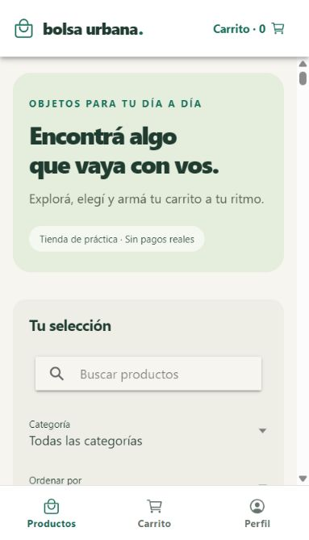
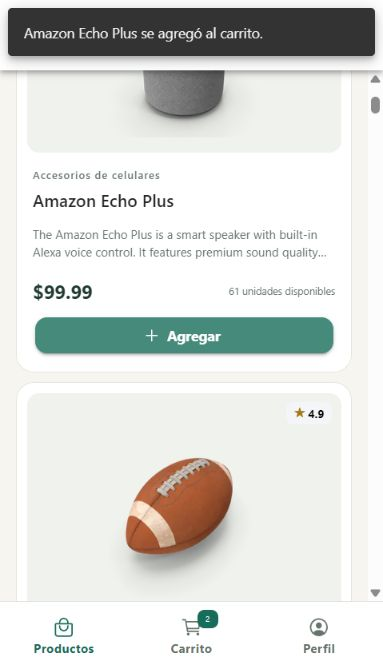
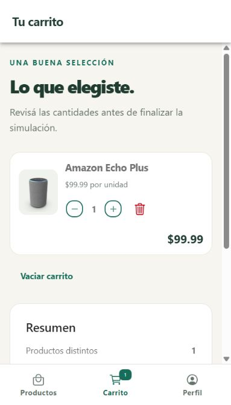
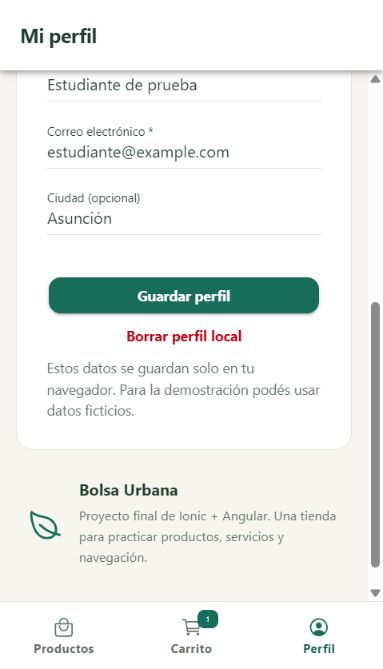

# Bolsa Urbana

Tienda online de práctica, sin pagos, desarrollada con Ionic + Angular. Proyecto final: opción 5.

**Integrante:** Kevinn Rolón.  
**Entrega prevista:** 2 de diciembre de 2026.  
**Repositorio:** [KevinnRolon/Proyecto-Ionic](https://github.com/KevinnRolon/Proyecto-Ionic).

## Cómo ejecutarlo

Usar Node.js 24 LTS y npm. No hace falta instalar Ionic CLI globalmente.

```bash
git clone https://github.com/KevinnRolon/Proyecto-Ionic.git
cd Proyecto-Ionic
npm ci
npm start
```

Abrir `http://localhost:4200`. El catálogo y las imágenes necesitan conexión a Internet.

```bash
npm run build
npm run lint
npm test -- --watch=false
```

La compilación de producción se genera en `www/`. Esa carpeta y `node_modules/` no se suben al repositorio. Para alojar la app, el servidor debe redirigir las rutas a `index.html`; subir solamente el código a GitHub no publica una web.

## Funciones

- **Productos:** catálogo JSON validado, búsqueda por texto sin tildes y por categorías en español, filtro de stock, orden por nombre, precio o calificación, precio máximo, carga, error y reintento. Las imágenes fallidas usan un respaldo local.
- **Carrito:** agregar, sumar, restar, quitar, vaciar con confirmación, contador de unidades y total en USD. La cantidad se limita al stock de demostración recibido de la API.
- **Perfil:** formulario con nombre, correo y ciudad opcional, mensajes de validación, guardado local y borrado con confirmación.
- **Compra simulada:** una alerta explica que no se cobrará ni enviará nada. La confirmación vacía el carrito.

El perfil y el carrito se conservan en `localStorage` del mismo navegador y origen. No hay cuentas, autenticación, base de datos, reservas de stock ni pedidos reales. Los datos del carrito son una copia local del catálogo, por lo que no constituyen una disponibilidad comercial actualizada.

## Fuente de datos

[DummyJSON Products](https://dummyjson.com/docs/products), endpoint `https://dummyjson.com/products` con `limit=0` y selección de los campos utilizados. Nombres, descripciones e imágenes provienen de esa API. Las categorías se presentan en español mediante un mapa local, conservando sus identificadores originales para filtrar. Precios de referencia en USD, sin conversión a guaraníes.

La URL se encuentra en **ambos** archivos:

- `src/environments/environment.ts`
- `src/environments/environment.prod.ts`

`ProductosService` es la única fuente HTTP; usa `providedIn: 'root'`, `HttpClient`, inyección por constructor y un tiempo máximo de espera de 15 segundos. El carrito administra estado local y no consulta otra API.

## Organización

```text
src/app/
  app.module.ts           Rutas y configuración de Ionic/HTTP
  models/producto.ts      Tipos del JSON y del carrito
  pages/productos/        Catálogo y filtros
  pages/carrito/          Cantidades, totales y simulación
  pages/perfil/           Formulario local
  services/               ProductosService y CarritoService
  tabs/                   Las tres pestañas e íconos
src/environments/         URL en desarrollo y producción
docs/                     Guía de estudio y capturas reales
IA.md                     Registro de asistencia de IA
```

## Relación con la consigna

| Requisito | Implementación |
| --- | --- |
| Tres tabs renombradas, con íconos diferentes | Productos, Carrito y Perfil; bolsa, carrito y persona |
| Servicio JSON y URL en ambos environments | `ProductosService.listar()` |
| Carga en `ngOnInit` e inyección por constructor | `ProductosPage` |
| Indicador de carga y mensaje de error | `ion-spinner`, texto de error y botón Reintentar |
| Cinco componentes de Ionic como mínimo | `ion-grid`, `ion-card`, `ion-badge`, `ion-range`, `ion-alert`, `ion-searchbar`, `ion-select`, `ion-button`, `ion-input`, `ion-list`, `ion-toast` |
| Repetición de datos, bindings y eventos | `@for`, `[src]`, `[(ngModel)]`, `(click)` |
| README, capturas y commits progresivos | Este documento, `docs/capturas/` e historial de Git |
| Uso de IA evidenciable | `IA.md` |

Se utiliza el control de flujo `@for` de Angular 22 para iterar los datos en lugar de la sintaxis histórica `*ngFor` mencionada en la rúbrica. La inyección por constructor se conserva expresamente como pide la consigna, con la regla de estilo correspondiente ajustada en ESLint.

## Capturas

Capturas reales de la aplicación en formato móvil; el perfil mostrado usa datos ficticios.

| Productos | Catálogo |
| --- | --- |
|  |  |

| Carrito | Perfil |
| --- | --- |
|  |  |

## Verificación

Se comprobaron la compilación de producción, ESLint y **13 pruebas automatizadas** sobre cantidades, totales en centavos, persistencia, datos corruptos o duplicados, fallos de almacenamiento, validación JSON, errores HTTP, filtros combinados, búsqueda sin tildes, orden y reintento. En navegador se probaron carga real del catálogo, búsqueda sin coincidencias, limpieza de filtros, navegación, cambios de cantidad, confirmación de simulación y persistencia del perfil y carrito al recargar. En la segunda revisión también se verificaron el filtro Solo con stock, las categorías traducidas y la cancelación del borrado del perfil.

El [recorrido de pruebas manuales](docs/PRUEBAS-MANUALES.md) incluye los pasos y resultados esperados. [Captura del filtro de stock](docs/capturas/filtros.jpg).

Para reproducir un fallo de red: abrir las herramientas de desarrollo del navegador, activar modo sin conexión y recargar Productos. Debe aparecer el error después de fallar la petición o cumplirse el tiempo de espera. Volver a conectar y pulsar Reintentar.

## Autoría y preparación de la entrega

La asistencia de IA se declara en [IA.md](IA.md). No se garantiza un porcentaje de detección. El historial contiene **20 commits** con cambios reales: **13** tienen a **Kevinn Rolón** como autor de Git y a **Codex** como coautor; los otros **7** tienen a Codex como autor. Esta atribución fue solicitada por el usuario y no representa 13 cambios escritos manualmente sin asistencia. No se modificaron las fechas ni los tres commits originales.

Antes de entregar, Kevinn debe revisar y comprender el código, registrar las modificaciones personales que realmente realice y comprobar con el docente la aceptación de `@for` y el criterio de uso de IA. La [guía de estudio](docs/GUIA-DE-ESTUDIO.md) explica el recorrido de los datos y propone ejercicios para practicar.
